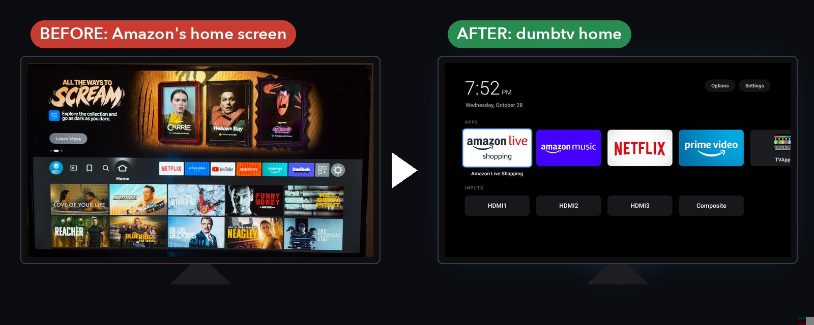
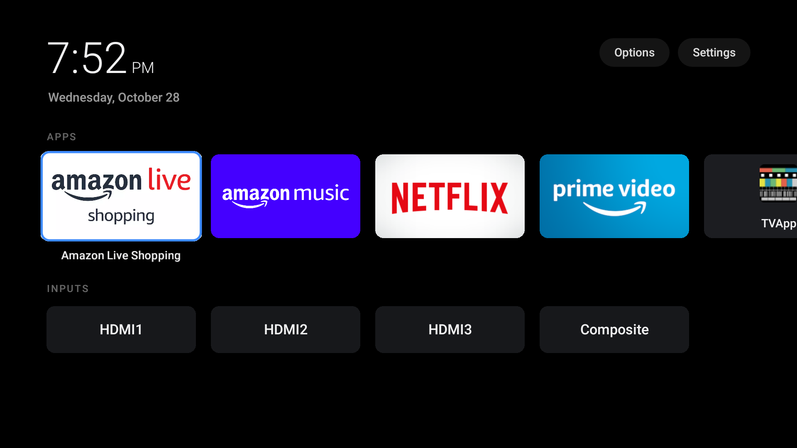
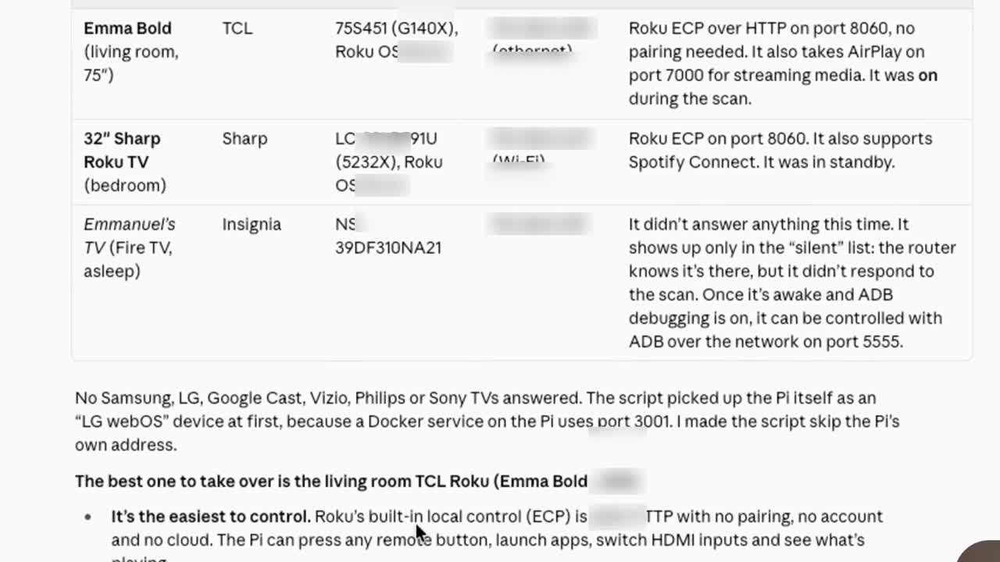
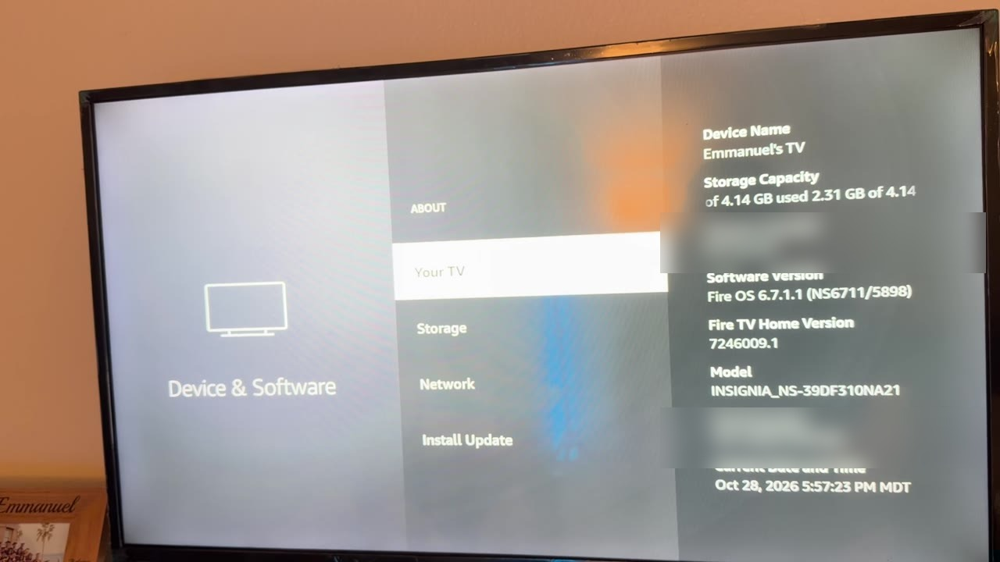
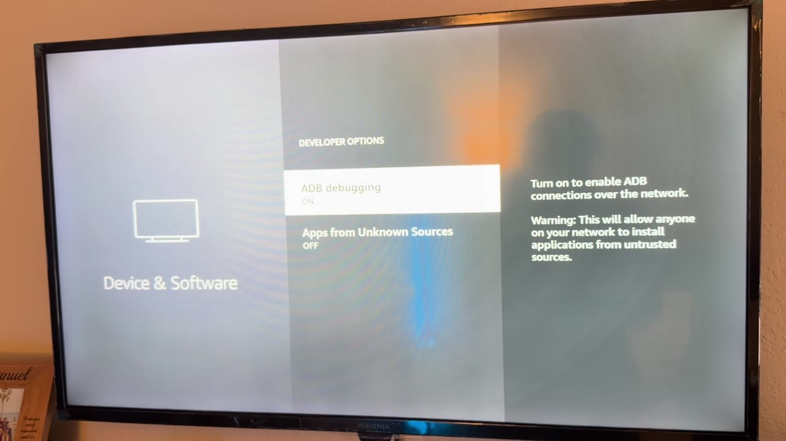
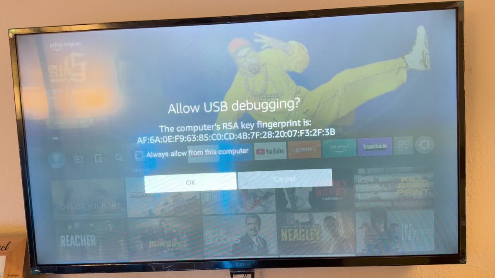
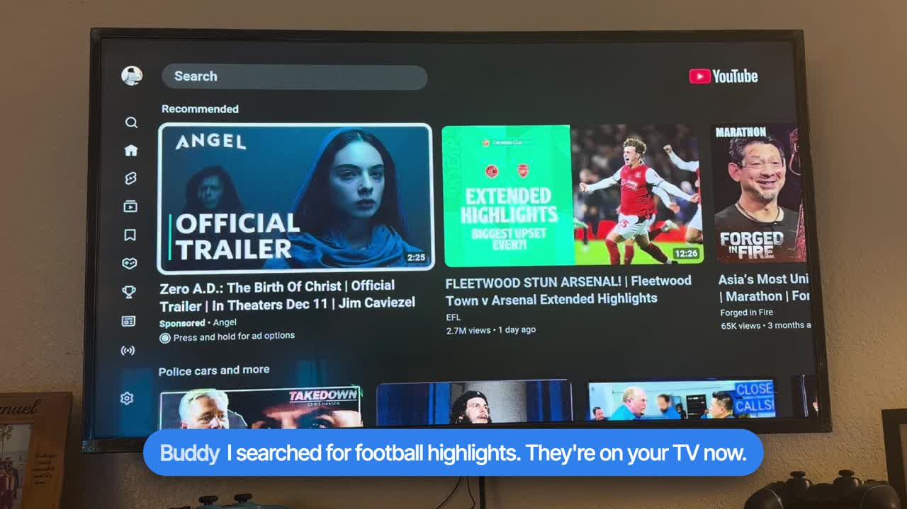
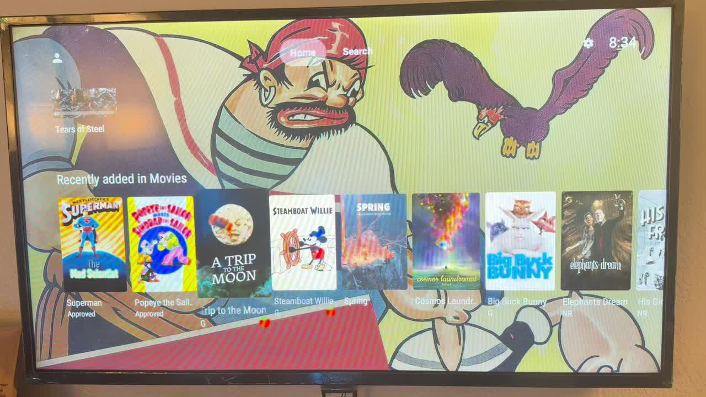

# My homelab took over my TV

I wanted my Raspberry Pi homelab and my AI assistant to be able to control my TV. Not through some cloud app, but straight over my home network. I also wanted to get rid of the Fire TV home screen, which is mostly ads for shows I never asked for.

With Claude Code doing most of the heavy lifting, that's what happened. This repo has everything I used: the prompts, the scripts, and the full write-up, so you can do the same thing on your own TV.



[](https://youtu.be/AkDbqhQuKdk)

> 🎬 **Watch the video:** [I Let My Homelab Take Over My TV](https://youtu.be/AkDbqhQuKdk)

---

## What you end up with

- A clean home screen on your Fire TV: a clock, your apps and your HDMI inputs, and nothing else.
- A `firetv` command that can press any remote button, open apps, change the volume, search Netflix and YouTube, and take screenshots.
- A small MCP server, so an AI assistant (Claude, or anything else that speaks MCP) can control the TV when you ask it to.
- Optional: your own homelab apps on the TV, like Jellyfin.

The new home screen comes from **[humblemuzzu/dumbtv](https://github.com/humblemuzzu/dumbtv)**, an open-source project that replaces the Fire TV home screen over ADB, without root. All the credit for the launcher itself goes to them. Everything here is the glue around it: finding the TV, connecting a homelab to it, and giving an assistant control.



---

## What you need

- **A TV that runs Android underneath.** Fire TV, Google TV and Android TV all work, because they have ADB (Android Debug Bridge). I used a 39" Insignia Fire TV on Fire OS 6.7.
  - Roku, Samsung (Tizen) and LG (webOS) TVs can be controlled in other ways, but you can't replace their home screens.
- **A computer on the same Wi-Fi as the TV.** I used a Raspberry Pi 5 homelab. A laptop works just as well.
- **[Claude Code](https://claude.com/claude-code)**, or another coding assistant you trust to run commands for you.

You don't need a homelab for any of this. If you only have a laptop, run everything from the laptop.

---

## How I did it

### 1. Find the TVs on your network

I started with one prompt and let Claude write a small scanner. It only sends read-only requests, so it never presses anything on your TVs.

> Find every smart TV on my home network from this computer. Use only read-only discovery (SSDP, mDNS and common TV ports) and don't press anything on the TVs. Give me a table with each TV's name, brand, model, IP address and how it can be controlled.

It found three TVs: two Rokus and my Fire TV. Claude actually recommended a Roku because it's the easiest to control, but a Roku won't let you replace its home screen, so I went with the Fire TV.



The scanner is in [`scripts/tv-scan.py`](scripts/tv-scan.py) if you want to run it yourself:

```bash
python3 scripts/tv-scan.py 192.168.1     # your network's first three numbers
```

### 2. Turn on developer options on the TV

This is the only part you have to do with the remote.

1. Go to **Settings → Device & Software** (on some Fire TVs it's called **My Fire TV**) → **About**.
2. Highlight your TV's name and press the **select** button **seven times**. It tells you you're now a developer.
3. Go back. There's a new menu called **Developer Options**. Turn on **ADB debugging**.

While you're on the About page, note your **Fire OS version** and your TV's **IP address** (under Network). You'll need both.

| About page | Developer Options |
|---|---|
|  |  |

ADB debugging lets any device on your home network try to connect to the TV. Only turn it on at home, and you can switch it off again any time.

### 3. Let Claude research your exact TV

Before changing anything, I asked Claude to research what actually works on my TV and Fire OS version, and to show me the sources.

> My TV is an Insignia Fire TV on Fire OS 6.7 with ADB debugging turned on. I want to replace its home screen with a clean one, without rooting it. Find well-maintained open-source projects that do this, tell me which ones were tested on my model and Fire OS version, and whether every change can be undone. Include sources. Don't run anything yet.

It found **dumbtv**, which had already been tested on an Insignia Fire TV running Fire OS 6.7, the same as mine. It doesn't need root, and it comes with an undo script.

### 4. Connect, and allow it on the TV

Claude installed ADB and connected to the TV. The first time a computer connects, the TV asks if you trust it. **Tick "Always allow from this computer"** and press OK. If you skip the tick box, the TV forgets and asks again every time.



Before touching anything, Claude ran dumbtv's read-only preflight check. It confirmed the model and software build matched what dumbtv was tested on.

### 5. Install only the new home screen

dumbtv can also do a much bigger cleanup (disabling Amazon apps, blocking tracking). I didn't want all of that, so I asked for the launcher only, and I asked to see every command first.

> Install only the new home screen from dumbtv, not the full cleanup. Read the install script first, show me every command it will run and the command that undoes it, and wait for my OK.

Claude downloaded the app, checked the file against its published checksum, and installed it. The launcher gets one permission, so it can notice when Amazon's home screen opens and put its own screen in front instead. Now when I press Home, I get the clean screen.

### 6. Control the TV from the command line

Claude then wrote [`scripts/firetv`](scripts/firetv), a small wrapper around ADB. It reconnects on its own when needed, so every command just works.

```bash
firetv status                      # is it awake, what's on screen, the volume
firetv open netflix                # or youtube, prime, jellyfin, home...
firetv home                        # any remote button: back, up, down, ok...
firetv volup 3
firetv search youtube "football highlights"
firetv shot                        # screenshot of the TV
```

The full list of commands is at the top of the script and in the [full guide](docs/FULL-GUIDE.md#7-the-firetv-command).

### 7. Let your AI assistant drive

[`scripts/firetv-mcp`](scripts/firetv-mcp) is a small MCP server (standard-library Python, nothing to install) with tools like `tv_open_app`, `tv_press`, `tv_volume` and `tv_search`. I connected it to Buddy, my own desktop assistant. Now I can just say "open Netflix on the TV".



To use it with Claude Code instead:

```bash
claude mcp add firetv -- ssh pi@homelab.local '~/.local/bin/firetv-mcp'
# or, if the TV is on the same machine's network and the scripts are local:
claude mcp add firetv -- /path/to/scripts/firetv-mcp
```

What works today: opening apps, going home, the volume, and searching Netflix and YouTube. What doesn't yet: picking a specific video from the results. You still do that last step with the remote.

### 8. Bonus: my homelab apps on the TV

I also had Claude put **Jellyfin** on the TV, so my own movies, served from the Raspberry Pi, are right there on the new home screen. Signing in is easy: Jellyfin shows a short code on the TV, and you type it in on your laptop.



---

## All the prompts

Every prompt I used, plus a few general ones for other TVs, is in **[prompts/PROMPTS.md](prompts/PROMPTS.md)**. They're written so you can paste them straight into Claude Code.

## The full write-up

**[docs/FULL-GUIDE.md](docs/FULL-GUIDE.md)** has everything:
- installing ADB without sudo
- the keepalive timer
- how the MCP server works
- making Jellyfin reachable from the TV
- every problem I hit and how it was fixed

---

## Undo everything

- **Get Amazon's home screen back:** `./launcher/install.sh --undo` in the dumbtv folder, then `adb uninstall tv.dumbtv.home` if you want the app gone too.
- **Stop the keepalive timer:** `systemctl --user disable --now firetv-keepalive.timer`
- **Close the door on the TV:** turn ADB debugging off in Developer Options.

## A few honest notes

- **ADB stays open while debugging is on.** Anyone on your Wi-Fi can try to connect, but the TV still asks before allowing a new computer. Keep it on a network you trust.
- **ADB can drop.** It drops when the TV is asleep or showing an HDMI input. The keepalive timer reconnects, and if ADB ever gets stuck, switching ADB debugging off and on fixes it.
- **Fire OS updates can change things.** If an update breaks the home screen, run dumbtv's undo and check their repo for news.

---

## What's in this repo

| Path | What it is |
|---|---|
| [`scripts/tv-scan.py`](scripts/tv-scan.py) | Read-only scanner that finds smart TVs on your network |
| [`scripts/firetv`](scripts/firetv) | Command-line remote for the Fire TV over ADB |
| [`scripts/firetv-mcp`](scripts/firetv-mcp) | MCP server so an AI assistant can control the TV |
| [`scripts/firetv.env.example`](scripts/firetv.env.example) | Where the TV's address goes (`~/.config/firetv.env`) |
| [`systemd/`](systemd/) | Timer that reconnects to the TV every minute |
| [`prompts/PROMPTS.md`](prompts/PROMPTS.md) | The prompts |
| [`docs/FULL-GUIDE.md`](docs/FULL-GUIDE.md) | The complete step-by-step record |

## Credits

- **[humblemuzzu/dumbtv](https://github.com/humblemuzzu/dumbtv)** for the home screen and the install and undo scripts.
- **[Jellyfin](https://github.com/jellyfin/jellyfin-androidtv)** for the Android TV app.
- **[Claude Code](https://claude.com/claude-code)**, which did most of the research and the scripting.

The scripts in this repo are MIT licensed. dumbtv and Jellyfin have their own licences.
