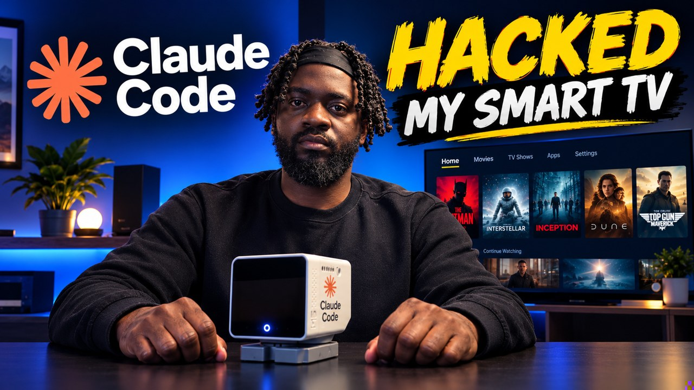

# Claude Code hacked my smart TV

I wanted my Raspberry Pi homelab and my AI assistant to be able to control my TV, straight over my home network. I also wanted to get rid of the Fire TV home screen, which is mostly ads for shows I never asked for.

With Claude Code doing most of the heavy lifting, that's what happened. This repo has everything I used: the prompts, the scripts, and the full write-up.

[](https://youtu.be/AkDbqhQuKdk)

> 🎬 **Watch the video:** [Claude Code Hacked My Smart TV](https://youtu.be/AkDbqhQuKdk)


---

## Pick your path

You don't need a homelab or your own AI assistant for this. I built it in layers, and each one works on its own:

| Path | What you need | What you get |
|---|---|---|
| **[1. Just a laptop](#path-1-just-a-laptop)** | A laptop on the same Wi-Fi as the TV, and Claude Code | A clean home screen, and a remote you can run from the terminal |
| **[2. Add an AI assistant](#path-2-let-an-ai-control-the-tv)** | Path 1, plus Claude Code or Claude Desktop | Ask in plain English: "open Netflix on the TV" |
| **[3. Add a homelab](#path-3-add-a-homelab)** | Path 1, plus an always-on computer like a Raspberry Pi | The TV stays connected 24/7, your own apps (like Jellyfin) on the TV, and control from anywhere in the house |

Most people should start with Path 1, and only go further if they want to.

### Will it work on my TV?

- **Fire TV, Google TV and Android TV:** yes. They all run Android underneath and have ADB (Android Debug Bridge), which is what everything here uses.
- **LG (webOS):** not with these scripts, but it can be done. [webos-vibehack](https://github.com/OmkarK97/webos-vibehack) installs a custom home screen through LG's official Developer Mode app (free LG developer account, no root). webOS always sends the Home button to LG's own screen, so a small watcher running on another device switches back to the custom one.
- **Samsung (Tizen):** yes, with Samsung's Developer Mode (no root needed for the basic version). The custom home screen is a regular Tizen app that reopens itself when you leave an app or turn the TV on, for example [dylanfernandezdelara/samsung-tv-launcher](https://github.com/dylanfernandezdelara/samsung-tv-launcher). A few projects go further and remap the real Home button on specific models: [mschr703/samsung-s95b-tizen-home-launcher](https://github.com/mschr703/samsung-s95b-tizen-home-launcher) (S95B) and [shiftynick/samsung-tv-launcher](https://github.com/shiftynick/samsung-tv-launcher) (S90D, uses temporary root). Check that your exact model was tested.
- **Roku:** partly. A custom launcher can be sideloaded as a developer channel that opens when the TV turns on, like [TraspJorge/Roku-launcher](https://github.com/TraspJorge/Roku-launcher), but the Home button still goes to Roku's own screen. Roku can also be fully controlled over the network with its ECP API.

These are young, small projects (most were created in the last few weeks), so read their READMEs and give Claude the link to check your model before installing anything.

I used a 39" Insignia Fire TV on Fire OS 6.7. The new home screen comes from **[humblemuzzu/dumbtv](https://github.com/humblemuzzu/dumbtv)**, an open-source project that replaces the Fire TV home screen over ADB, without root. All the credit for the launcher itself goes to them.


---

## Path 1: Just a laptop

All you need is a laptop (macOS or Linux; on Windows, use WSL) on the same Wi-Fi as the TV, and [Claude Code](https://claude.com/claude-code). Every prompt below is also in **[prompts/PROMPTS.md](prompts/PROMPTS.md)**, ready to copy.

### Step 1: Turn on developer options on the TV

This is the only part you have to do with the remote.

1. Go to **Settings → Device & Software** (on some Fire TVs it's called **My Fire TV**) → **About**.
2. Highlight your TV's name and press the **select** button **seven times**. It tells you you're now a developer.
3. Go back. There's a new menu called **Developer Options**. Turn on **ADB debugging**.

While you're on the About page, note your **Fire OS version** and your TV's **IP address** (under Network).

| About page | Developer Options |
|---|---|
|  |  |

ADB debugging lets devices on your home network ask to connect to the TV. The TV still asks you before allowing a new one, but only turn it on at home. You can switch it off again any time.

### Step 2: Find your TV

If you already know your TV's IP address, you can skip this. Otherwise, give Claude this:

> Find the smart TVs on my home network from this computer. Use only read-only discovery (SSDP, mDNS and common TV ports) and don't press anything on the TVs. Give me a table with each TV's name, brand, model, IP address and how it can be controlled.

Or run the scanner from this repo yourself. It works out your network automatically and never presses anything:

```bash
python3 scripts/tv-scan.py
```


When I ran it, it found three TVs: two Rokus and my Fire TV. Claude recommended a Roku because it's the easiest to control, but a Roku won't let you replace its home screen, so I went with the Fire TV.

### Step 3: Let Claude research your exact TV

Before changing anything, ask Claude to research what actually works on your TV and show you its sources:

> My TV is a `<brand and model>` running `<Fire OS / Android TV version>`, and ADB debugging is on. I want to replace its home screen with a clean one, without rooting it. Find well-maintained open-source projects that do this, tell me which ones were tested on my model and version, and whether every change can be undone. Include sources. Don't run anything yet.

For my TV it found **dumbtv**, which had already been tested on an Insignia Fire TV running Fire OS 6.7, the same as mine.

### Step 4: Connect, and allow it on the TV

> Install adb on this computer if it isn't there, connect to my TV at `<TV IP>:5555`, and run a read-only check that tells me the model and software build. Don't change anything on the TV yet.

The first time a computer connects, the TV asks if you trust it. **Tick "Always allow from this computer"** and press OK. If you skip the tick box, the TV forgets and asks again every time.


### Step 5: Install only the new home screen

dumbtv can also do a much bigger cleanup (disabling Amazon apps, blocking tracking). I only wanted the new home screen, and I wanted to see every command first:

> Install only the new home screen from dumbtv, not the full cleanup. Read the install script first, show me every command it will run and the command that undoes it, and wait for my OK.

Claude downloaded the app, checked the file against its published checksum, and installed it. The launcher gets one permission, so it can notice when Amazon's home screen opens and put its own screen in front instead. Now when I press Home, I get the clean screen.

### Step 6: A remote in your terminal

[`scripts/firetv`](scripts/firetv) is a small wrapper around ADB that runs on macOS and Linux. Copy it somewhere on your PATH, put your TV's address in `~/.config/firetv.env`, and you're done:

```bash
cp scripts/firetv ~/.local/bin/ && chmod +x ~/.local/bin/firetv
echo 'FIRETV_ADDR=192.168.1.50:5555' > ~/.config/firetv.env      # your TV's IP

firetv status                      # is it awake, what's on screen, the volume
firetv open netflix                # or youtube, prime, jellyfin, home...
firetv home                        # any remote button: back, up, down, ok...
firetv volup 3
firetv search youtube "football highlights"
firetv shot                        # screenshot of the TV
```

It reconnects on its own when it needs to. The full list of commands is at the top of the script.

That's Path 1 done. The rest is optional.

---

## Path 2: Let an AI control the TV

You don't need to build your own assistant for this. Claude Code (or Claude Desktop) can be the assistant.

[`scripts/firetv-mcp`](scripts/firetv-mcp) is a small MCP server: standard-library Python, nothing to install. It gives the AI tools like `tv_status`, `tv_open_app`, `tv_press`, `tv_volume` and `tv_search`. It calls the `firetv` command from Path 1, so keep both files in the same folder.

```bash
cp scripts/firetv-mcp ~/.local/bin/ && chmod +x ~/.local/bin/firetv-mcp
claude mcp add firetv -- ~/.local/bin/firetv-mcp
```

Then just ask Claude: *"open YouTube on the TV and search for football highlights"*.

I connected the same server to Buddy, my own desktop assistant, so I can do it by voice:


What works today: opening apps, going home, the volume, and searching Netflix and YouTube. What doesn't yet: picking a specific video from the results. You still do that last step with the remote.

---

## Path 3: Add a homelab

This is my setup. A Raspberry Pi 5 is always on, so the TV is always reachable, even when my laptop is closed.

- **The same scripts, on the Pi.** Put `firetv` and `firetv-mcp` in `~/.local/bin` on the Pi, and the TV address in `~/.config/firetv.env`.
- **A keepalive timer.** ADB over Wi-Fi drops when the TV sleeps. [`systemd/`](systemd/) has a timer that reconnects every minute:
  ```bash
  cp systemd/firetv-keepalive.* ~/.config/systemd/user/
  systemctl --user daemon-reload && systemctl --user enable --now firetv-keepalive.timer
  loginctl enable-linger $USER      # keep it running when you're logged out
  ```
- **Control from any computer.** Your assistant runs the MCP server on the Pi over SSH:
  ```bash
  claude mcp add firetv -- ssh pi@homelab.local '~/.local/bin/firetv-mcp'
  ```
- **Your own apps on the TV.** I had Claude put **Jellyfin** on the TV, so my own movies, served from the Pi, are right there on the new home screen. To sign in, Jellyfin shows a short code on the TV and you type it in on your laptop.


**[docs/FULL-GUIDE.md](docs/FULL-GUIDE.md)** has every detail of this setup:
- installing ADB on the Pi without sudo
- how the MCP server works
- making Jellyfin reachable from the TV
- every problem I hit and how it was fixed

---

## Undo everything

- **Get Amazon's home screen back:** run `./launcher/install.sh --undo` in the dumbtv folder, then `adb uninstall tv.dumbtv.home` if you want the app gone too.
- **Stop the keepalive timer (Path 3):** `systemctl --user disable --now firetv-keepalive.timer`
- **Remove it from Claude (Path 2):** `claude mcp remove firetv`
- **Close the door on the TV:** turn ADB debugging off in Developer Options.

## A few honest notes

- **ADB stays open while debugging is on.** Anyone on your Wi-Fi can ask to connect, but the TV still asks before allowing a new computer. Keep it on a network you trust.
- **ADB can drop.** It drops when the TV is asleep or showing an HDMI input. If ADB ever gets stuck, switching ADB debugging off and on fixes it.
- **Fire OS updates can change things.** If an update breaks the home screen, run dumbtv's undo and check their repo for news.

---

## What's in this repo

| Path | What it is | Used in |
|---|---|---|
| [`prompts/PROMPTS.md`](prompts/PROMPTS.md) | The prompts, ready to paste | All paths |
| [`scripts/tv-scan.py`](scripts/tv-scan.py) | Read-only scanner that finds smart TVs on your network | Path 1 |
| [`scripts/firetv`](scripts/firetv) | Command-line remote for the TV over ADB | Path 1 |
| [`scripts/firetv.env.example`](scripts/firetv.env.example) | Where the TV's address goes (`~/.config/firetv.env`) | Path 1 |
| [`scripts/firetv-mcp`](scripts/firetv-mcp) | MCP server so an AI can control the TV | Path 2 |
| [`systemd/`](systemd/) | Timer that reconnects to the TV every minute | Path 3 |
| [`docs/FULL-GUIDE.md`](docs/FULL-GUIDE.md) | The complete record of my homelab setup | Path 3 |

## Credits

- **[humblemuzzu/dumbtv](https://github.com/humblemuzzu/dumbtv)** for the home screen and the install and undo scripts.
- **[Jellyfin](https://github.com/jellyfin/jellyfin-androidtv)** for the Android TV app.
- **[Claude Code](https://claude.com/claude-code)**, which did most of the research and the scripting.

The scripts in this repo are MIT licensed. dumbtv and Jellyfin have their own licences.
